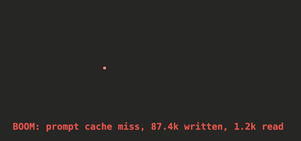

# cache-boom

A Claude Code mod that plays an explosion above the prompt when a model call misses the prompt cache.

A cache miss means Claude Code wrote the conversation to the cache again instead of reading it. That costs 12.5x to 80x a cache read, depending on the cache lifetime and the model. Misses are easy to cause and invisible by default: switching models, editing an early message, a slow reply that lets the cache expire, an MCP server reconnecting. cache-boom makes each one visible as it happens, in the main conversation and in subagents.

In the terminal:


In the desktop app:



## Install

At the prompt of a Claude Code terminal session:

```
/plugin install cache-boom --marketplace akaike-byob/cache-boom
```

From a shell:

```
claude plugin install cache-boom --marketplace akaike-byob/cache-boom
```

Answer `y` to add the marketplace, then pick a scope. The user scope turns it on for every session.

In the desktop app: click + next to the prompt box, then Plugins, Add marketplace with `akaike-byob/cache-boom`, then Add plugin.

Works in the terminal and the desktop app. Requires Claude Code 2.1.300 or later. Mods are an early-access feature and their API may change between releases.

## What you see

After each model call, the mod checks the call's cache usage:

| Event | Rule | Label above the prompt |
| --- | --- | --- |
| Cache miss | 5,000 tokens or more written, and more written than read | `BOOM: prompt cache miss, 87.4k written, 1.2k read` |
| Huge write | 50,000 tokens or more written | `BOOM: huge cache write, 62.0k tokens` |

A call from a subagent says so: `BOOM: subagent prompt cache miss, ...`.

An animated explosion plays above the label for about 1.6 seconds. The label then stays for 8 more seconds, so you can read it. The terminal draws it in character cells. The desktop app draws the same explosion as an animated SVG. Other surfaces show the label alone.

Small writes are normal and stay quiet. Each turn writes its new messages, a few hundred to a few thousand tokens.

To see it once with sample numbers, run:

```
/cache-boom:boom
```

Typing `boom` at the prompt finds it.

## Status line report

The mod writes a small report for your status line to `~/.claude/cache-boom/<session id>.json`:

```json
{
  "blastCount": 2,
  "lastBlast": { "kind": "miss", "cacheWriteTokens": 87400, "cacheReadTokens": 1200, "isSubagent": false }
}
```

- `blastCount` counts the explosions since your last prompt. Each prompt resets it to 0.
- `kind` is `miss` or `write`.

To show it in a status line script, read the session id from the status line's JSON input:

```bash
input=$(cat)
session_id=$(printf '%s' "$input" | jq -r '.session_id // empty')
report="$HOME/.claude/cache-boom/${session_id}.json"
if [ -n "$session_id" ] && [ -f "$report" ]; then
  jq -r 'select(.blastCount > 0) | .lastBlast as $b
    | "boom x\(.blastCount): \(if $b.isSubagent then "sub " else "" end)\($b.kind) \($b.cacheWriteTokens / 100 | floor / 10)k"' "$report"
fi
```

The mod writes one file per session and never deletes them. Each is under 200 bytes. Clear old ones with `find ~/.claude/cache-boom -mtime +30 -delete`.

## Privacy

The mod makes no network calls. It reads the `HOME` environment variable and writes only the report file above.

## Uninstall

```
/plugin uninstall cache-boom
```

Then delete `~/.claude/cache-boom/` if you no longer want the reports.

## Development

Run it from a checkout:

```
claude --plugin-dir /path/to/cache-boom
```

Check and test:

```
claude plugin validate .
claude plugin test .
```

Claude Code writes the API types to `.claude-plugin/types/` the first time it loads the mod. After that, `tsc -p .` type-checks the mod. That folder is generated and ignored by git.

Layout:

| Path | Contents |
| --- | --- |
| `.claude-plugin/plugin.json` | Manifest. |
| `.claude-plugin/marketplace.json` | Lets this repository serve as its own marketplace. |
| `commands/boom.md` | Declares `/cache-boom:boom`, so the desktop app lists it before a session starts. `hooks/register.tsx` answers it. |
| `hooks/register.tsx` | The mod. |
| `types/index.d.ts` | The mod's state contract and report types. |
| `tests/blast.test.tsx` | Tests, run by `claude plugin test`. |
| `assets/explosion.svg` | The terminal README animation, drawn from the mod's own frames. |
| `assets/desktop-explosion.gif` | The desktop README animation, captured from `drawAnimatedSvg`. |
| `scripts/explosion-image/` | Regenerates `assets/explosion.svg`. |

After changing the explosion, regenerate the README animation:

```
cd scripts/explosion-image
bun --preload ./stub-claude-code.ts ./dump-frames.ts ../../hooks/register.tsx > /tmp/frames.json
python3 render-svg.py /tmp/frames.json ../../assets/explosion.svg
```

## License

MIT
